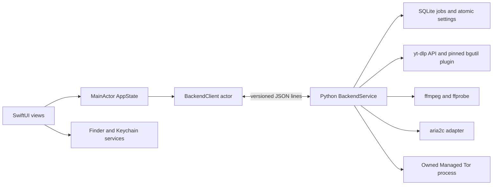

# Swift migration architecture — review draft

Design date: 1 October 2026. Reference: Python baseline
`6a024ec97d2521beed1c6cce2752aaa605425390`, provider
`7608dd51ee813b48cf9a6d68c6e42cb197ce10e0` (1.3.1).
This is a design, not an implemented native app or an authorization to port it.

## Goal and constraints

Gradually replace desktop presentation with a native SwiftUI macOS application,
preserving the tested download engines and the Python app as the comparison and
rollback route. Swift owns menus, Finder integration, Keychain access, and view
state. Extraction remains yt-dlp; media processing remains ffmpeg/ffprobe;
torrents remain aria2c. No human-readable yt-dlp output becomes a frontend API.
No private cookies, signing certificates, or owner's local Xcode are needed for
early development. Source edits happen in Cloud; native validation happens in
GitHub Actions on an authorized hosted macOS runner.

Target macOS 12 initially, matching the current bundle. Use ObservableObject
and @Published rather than requiring newer Observation APIs. Reconsider the
deployment target only through a separate product decision. Exact Swift and
Xcode versions must be pinned after the first hosted toolchain qualification;
the initial CI deliberately records the runner's supplied Swift version.

## Baseline evidence and the Cloud failure

Cloud is Linux x86_64 with Python 3.12.14, PySide6 6.11.2, yt-dlp
2026.08.19, pytest 8.4.2, and native Debian ffmpeg/ffprobe 7.1.5.
The initial full run was 221 passed, 1 failed. The failure was
`tests/test_settings_window.py::test_authentication_controls_and_targeted_reset_do_not_change_other_settings`.

`auth.browser_profiles` discovers Chromium-family profiles beneath macOS
Library/Application Support. If none are discovered it returns the display
label Default with an empty profile value. `_reset_authentication` selects that
first entry; `authentication_options` converts the empty profile into None for
yt-dlp's browser-profile selection. The test assumed a developer's installed
Chrome Default directory and expected the literal string Default. That is a
test isolation bug, not an application portability regression: a clean macOS
home also returns an empty value. The application advertises macOS support,
not cross-platform browser-profile discovery. Linux source tests remain valid.

The correction isolates Path.home to an empty temporary directory and asserts
both the exact reset values and the resulting yt-dlp cookiesfrombrowser tuple.
No Chrome directory is created, no assertion is skipped, and application code
is unchanged. Existing `test_auth.py` covers macOS friendly-name discovery and
explicit profile forwarding. Targeted auth/settings tests: 19 passed. Full
suite: 222 passed, no skipped or expected failures. Native UI, browser cookie
access, live private downloads, live Tor/torrents, and packaging are unvalidated.

## Backend choices

| Concern | A: SwiftUI + Python API worker | B: direct yt-dlp subprocess | C: Swift orchestration + selected Python adapters |
| --- | --- | --- | --- |
| Behavior parity | Reuse analysis/download/format/processing policies | CLI JSON/progress-template adapters needed; much policy must be rebuilt | Gradual reuse possible, but two orchestration implementations |
| Authentication/cookies | Existing Python attempt policy and cookiesfrombrowser/cookiefile | CLI flags supported, but retry/effective-mode policy must be ported | Split policy risks inconsistent analysis/download behavior |
| Playlists/preview | Existing MediaItem conversion and ordering | Structured dump JSON is viable; streaming expansion needs an adapter | Native aggregation must agree with Python candidate IDs |
| Progress/retries | Hooks, stages, warnings, bounded retries, one metadata refresh retained | Structured progress templates possible; cannot infer everything from logs | Swift scheduler must coordinate Python operation state |
| Provider/runtime | Existing import discovery, snapshots, verification and rollback | Plugin paths and executable updates require separate qualification | Ownership of active versions becomes more complex |
| Proxy/Tor | Retain explicit routing and owned-process rules | Swift must port auth/routing/retry glue | More IPC/native resource ownership boundaries |
| ffmpeg/torrents | Existing converters and aria2 adapter retained | yt-dlp CLI alone does not supply general converter or torrents | Native process adapters possible after parity evidence |
| Packaging/size | Python runtime and plugins required; Qt can leave worker later | yt-dlp standalone may still include Python; extra native engines remain | Usually both Python and native adapters, no assumed size saving |
| Maintainability/testing | One domain implementation; Python fixtures plus protocol tests | More Swift policy; CLI-version fixtures and compatibility tests | Highest boundary/test complexity during transition |
| Distribution | Bundle architecture-matched worker/tools, licensing review | Bundle matching CLI/tools, licensing and update review | Same packaging plus coordination of multiple engine releases |
| Failure isolation | Worker crash isolated from UI; process contains shared jobs | Per-job process isolation, greater startup cost | Isolation depends on adapter boundaries |

Recommend A initially. It preserves the Python API's structured semantics with
the least behavioral churn. This is a hybrid product (Swift UI plus Python and
native engines), but not option C's split domain orchestration. B is technically
possible using structured CLI outputs; naive terminal parsing is rejected. C
may become appropriate for individual proven adapters later, not as the first
migration step. Python/engine packaging cost remains; removing Qt from a
headless worker is a later verified outcome, not an immediate assumption.

## Modules and ownership

| Proposed module | Responsibility and interface | Dependencies |
| --- | --- | --- |
| MorganApp | Window, Download, Queue, History, Console, Settings, menus, preview selection | AppState, platform services |
| MorganDomain | Codable protocol DTOs, job IDs, status, safe errors, options | Foundation only |
| BackendClient | Owned Process, framed pipes, handshake, correlation, timeouts, AsyncStream events | Domain; no widget references |
| AppState | @MainActor ObservableObject; reduce snapshots/events; selections keyed by job ID | BackendClient, Domain |
| PlatformServices | NSWorkspace open/reveal, native file panels/Trash, Security framework secrets | AppKit/Security, explicit worker grants |
| Python BackendService | Command validation, scheduler, job state, persistence, engine adapters | Existing Python domain modules |
| Protocol fixtures | Sanitized commands/events and parity cases shared by Python/Swift tests | Future shared/protocol/v1/ |

No Swift process writes the legacy job database. BackendService serializes writes
and retains Database's jobs table, JSON snapshots and WAL semantics; History is
a query on the same jobs. At first extract orchestration currently embedded in
`ui.py` into a service with adapters used by both Qt and IPC. `tasks.py` currently
depends on Qt: do not pretend it is a headless worker. Extract its ownership and
cooperative cancellation contract into a non-Qt scheduler, leaving a Qt adapter
for existing UI tests. Compare existing Qt and headless flows before native UI
depends on this extraction. Pure media modules should retain behavior.

## State, lifecycle, and concurrency

Worker is authoritative for durable jobs, scheduler state, options captured at
dispatch, and inventories. Swift stores presentation/selection, not a second
queue. A job snapshot includes stable UUID, media item, kind, options, durable
status, transfer metrics, warnings, verification, diagnostics, effective auth,
connection/Tor state and file inventory. Protocol DTOs explicitly sanitize the
legacy model; do not serialize raw dataclass contents to IPC by default.

The scheduler retains strong ownership until tasks and child processes stop.
Use bounded independent slots for media, torrents, analysis, diagnostics, and
updates, matching existing settings rather than a single serial work queue.
Events carry attempt_id and job_revision so late progress cannot overwrite a
Pause, Cancel, Restart, or newer attempt. Presentation updates run on MainActor.
Coalesce progress, retain terminal states and errors, and never infer Downloading
from a running process before format resolution succeeds.

Pause/Cancel are requests, not immediate acknowledgements of stopped execution.
Resume/Retry keep partial data. Restart waits for the prior task to exit before
deleting recorded state and starting a new attempt; replacing final files needs
explicit confirmation. Removal distinguishes list-only from deleting owned
files. Swift Finder/Trash operations require a short-lived worker grant while
the job is quiescent; the worker revalidates inventory and completes persistence
only after the native result, avoiding concurrent deletion by two owners.

On IPC failure, stop issuing mutations, preserve last-known state, and reconnect
using a full snapshot from a new worker session. Active persisted jobs reload
Interrupted; never automatically replay enqueue, deletion, or Restart. Launch
uses an exclusive application-data lock so Qt and native apps cannot write the
same database concurrently. Rollback closes the worker and opens the unchanged
Python app; until schema rollback is tested, native previews use a separate copy
of legacy state. No in-place schema upgrade is required by this design.

## Auth, network, and runtime boundaries

Settings preserve Auto public-first, explicit browser/imported-cookie modes,
and private-content failure rules. Browser profile discovery remains a backend
macOS concern; an empty profile means yt-dlp chooses it. Swift holds Keychain
access; passwords travel only via a private local command, never argv, settings,
events, or logs. Cookie files are paths selected by the user, not copied cookie
contents. Permission failures become actionable auth errors, not bypasses.

Capture a routing snapshot per attempt: Direct/System use system routing;
HTTP/SOCKS are explicit; socks5h retains remote DNS. Do not claim a VPN is active
from the System option. Tor process/bootstrap/SOCKS/Internet/target states remain
distinct. External Tor is never owned or stopped. Managed Tor owns isolated data,
dynamic ports and control-cookie authentication. Automatic circuit retries
remain gated for review; no new retry or identity-changing loop is approved.

Provider plugin stays upstream/pinned; HTTP health and compiled script readiness
are separate. App does not automatically start its server. Runtime updates retain
official-source SHA256 verification, structural/version/provider checks, atomic
activation, rollback, bundled fallback, and immutable per-attempt snapshots.
Updater/provider/diagnostic routing must be described independently from media
routing. Runtime plugin compatibility and macOS distribution rules for downloaded
executable Python code require a release decision before shipping.

## Engines, diagnostics, and security

Reuse QuickTime source selection, copy-versus-transcode plans, ffprobe/Mutagen
verification, atomic subtitle mux and persistent optional warnings. Native
conversion UI supplies typed options; backend validates container/codec choices
and verifies temporary output before publish. Cancellation/stdout/stderr draining
gaps must be fixed and tested separately before native conversion is enabled.
Retain aria2 metadata selection/private tracker safeguards, Direct/System-only
peer routing and honest peer/seed counters. Existing aria2 console parsing remains
an internal adapter; a future RPC adapter needs a separate approved parity task.

Safe errors carry category, stage, code, retry options and message. Console remains
bounded/redacted; raw tracebacks, cookie values, signed URLs, thumbnail request
headers and proxy passwords never enter IPC logs or durable DTOs. Review string
redaction against structured field allowlists; it is not proof every secret is
removed. File access is limited to user-selected roots and recorded inventories;
do not trust an arbitrary frontend pathname as authority to delete it.

## Layout, distribution, and validation

Keep `src/`, `tests/`, scripts and resources where they are. Add `swift/` only when
native source is separately authorized; add `shared/protocol/v1/` with fixtures
during protocol extraction. Moving the entire Python tree brings no parity
benefit. App bundle later contains Swift executable, architecture-matched Python
worker/runtime, plugin and licensed engines. Do not assume universal2 support or
an App Store sandbox; qualify arm64 and x86_64 independently on hosted macOS.
Signing, notarisation, hardened-runtime and sandbox/bookmark policy belong to the
release phase; CI build/test starts without certificates.

Read [BACKEND_PROTOCOL.md](BACKEND_PROTOCOL.md),
[BEHAVIOUR_PARITY_CHECKLIST.md](BEHAVIOUR_PARITY_CHECKLIST.md),
[MIGRATION_PHASES.md](MIGRATION_PHASES.md), and
[NATIVE_CI_DESIGN.md](NATIVE_CI_DESIGN.md) together. Review this design before any
backend extraction or Swift implementation. No worker, protocol implementation,
native UI, Swift package, signing or distribution changes are included now.
